# The Hollow Below — Nightmare Worlds Roadmap

[Project board](https://github.com/users/RyanVerWey/projects/30) · [Milestones](https://github.com/RyanVerWey/the-hollow-below-alpha/milestones) · [All roadmap issues](https://github.com/RyanVerWey/the-hollow-below-alpha/issues?q=label%3Anightmare-roadmap)

**100 original improvement goals, plus the requested results/party flow and final-objective hunt.** This is a quality-driven delivery sequence, not a dated launch promise. The original acceptance contract stays intact.

## Where we are

13 original criteria have bounded independent acceptance. The remaining criteria are open: much of the current candidate is implemented, but code, renders and small tests alone do not establish final gameplay or visual quality. The current public download is older than these internal review builds.

Current integration candidate: Windows0.22.20. New models, results and final pressure are being checked; it is not advertised as a verified release.

## Visual destination — concept art

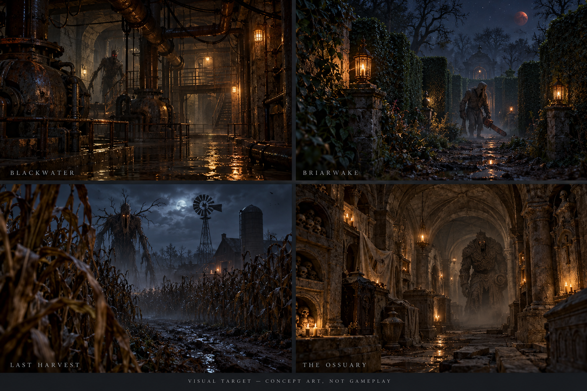

AI-generated production direction: material depth, useful props, low practical lighting, distinct monsters and readable haze. This is **not gameplay** and does not establish current fidelity. The target should guide asset, lighting and animation reviews rather than substitute for them.

## Delivery milestones

| Milestone | Outcome | Order and dependency |
|---|---|---|
| 01 - Playable alpha: fair hunts and round flow | The immediate playable update: objectives teach and help, sound and line-of-sight have fair consequences, final escape creates pressure, results explain the run, and multiplayer groups stay connected. | Current playable focus |
| 02 - Human survivors and cooperative presence | Four recognizably human survivors with grounded locomotion, readable hands and faces, convincing concealment, held lights, interaction and replicated body language. | Current playable focus |
| 03 - Blackwater: industrial depth and the Repeater | A wet, decaying pumping station with dimensional machinery, useful hiding and route props, readable darkness, and an organic red-eyed listening predator. | Parallel art/audio; integrate after the shared loop |
| 04 - Briarwake: living estate and chainsaw terror | Tight layered hedges, trees, dirt paths, lanterns clear of foliage, a blood-moon sky and fog. The demonic Farmer must hold, carry and attack with a heavy chainsaw convincingly. | Current playable focus |
| 05 - Last Harvest: corn maze and the Harvester | A connected cold-night corn maze with farm landmarks, beneficial machinery objectives and an alien husk creature whose senses, scares and motion distinguish it from the Farmer. | Parallel art/audio; integrate after the shared loop |
| 06 - The Ossuary: labyrinth and the Penitent | A connected vaulted stone labyrinth with ritual objectives, crypt landmarks, dust and echo. A heavy carved guardian has readable committed attacks and its own phase changes. | Parallel art/audio; integrate after the shared loop |
| 07 - Sound: presence, pursuit and player control | Creature presence carries through halls, proximity warns before visibility, investigation and pursuit have distinct transitions, footsteps belong to surfaces and every audio category can be controlled. | Parallel art/audio; integrate after the shared loop |
| 08 - Performance: depth within a measured budget | Preserve nearby visual depth while bounding foliage, lighting, shadows, repeated geometry, allocations and effects. Use native measurements rather than editor FPS or triangle counts alone. | Continuous measured budget |
| 09 - Windows alpha: native acceptance and delivery | Every world and difficulty must be solvable and playable in solo and four-player sessions, with sustained performance, readable moving art and a clean installer/launcher. Publish only a tested coherent build. | Final integration gate |

Immediate focus: complete the round loop and fair final escape, ship the improved human/monster candidates in one playable build, then finish each world’s distinctive art and encounters. Performance and independent tests run alongside that work.

## Current game — unmodified native captures

These images come from actual Windows review builds. They are not generated or brightened. Inspection routes use real world cameras and controller movement, with gameplay AI disabled for the recorded route; they do not prove a live hunt, keyboard play, four-client networking or performance.

### BLACKWATER — Windows-v02215-worlds-review

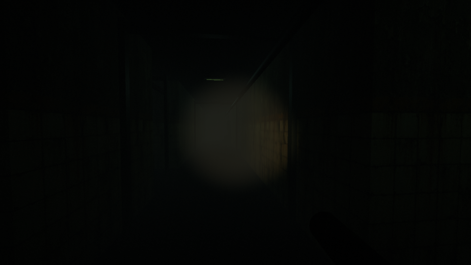

Current native corridor view: flashlight-lit station tiles recede into continuous depth haze. The station remains very dark; this view does not show machinery or room dressing clearly.

### BRIARWAKE ESTATE — Windows-v02218-worlds-review

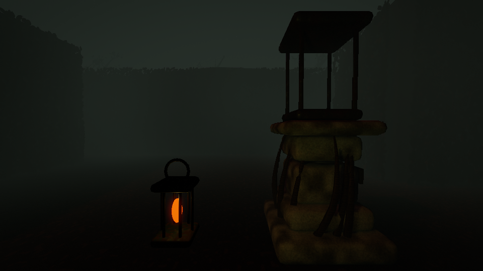

Native estate view after the ward-placement correction: a three-dimensional masonry lantern ward sits beside the clear approach, with hedge layers fading behind it. Foliage and stone remain dark. This is a current-state image, not final environment-art approval.

### THE LAST HARVEST — Windows-v02215-worlds-review

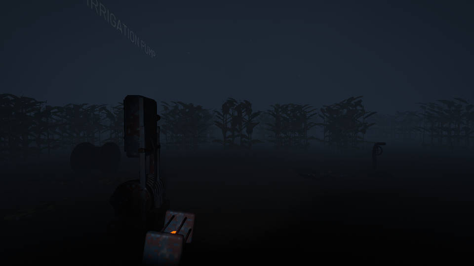

Native field route: an irrigation pump clearing, layered corn rows and distant farm silhouettes beneath the night sky. Blue haze reduces distant contrast, and the open ground still needs stronger visual dressing.

### THE OSSUARY — Windows-v02215-worlds-review

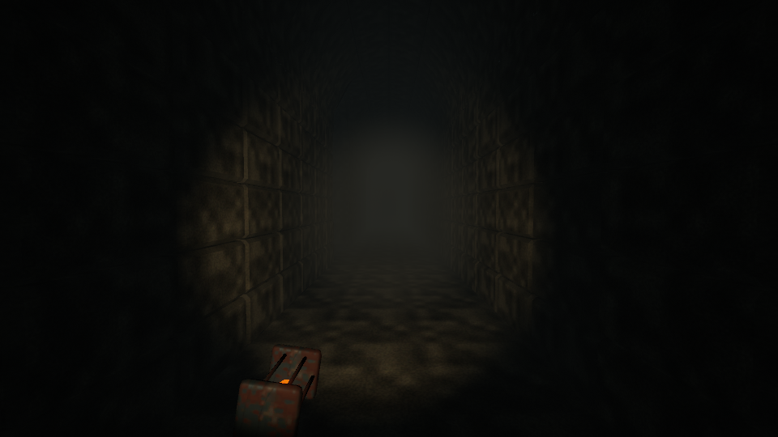

Native crypt corridor: warm near stone, irregular floor relief and cooler haze down the passage. The image remains dim. It demonstrates a corridor rather than the full ritual-room dressing.

## Monsters — current candidate versus direction

The Farmer and Stone candidates below are actual native19 studio renders. The Farmer image predates a boot/garment correction in20; the Stone chest shadow still needs attention. Corn is an output-only source concept. None is final art approval.

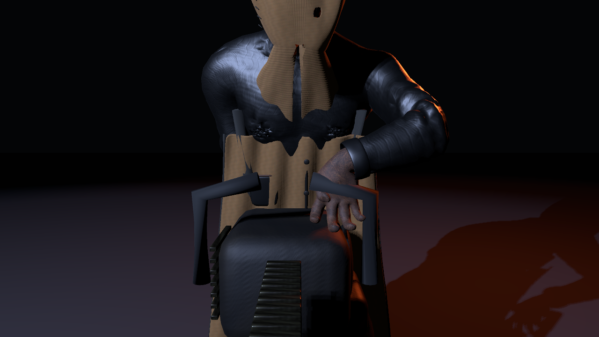

Farmer — actual native19 review.

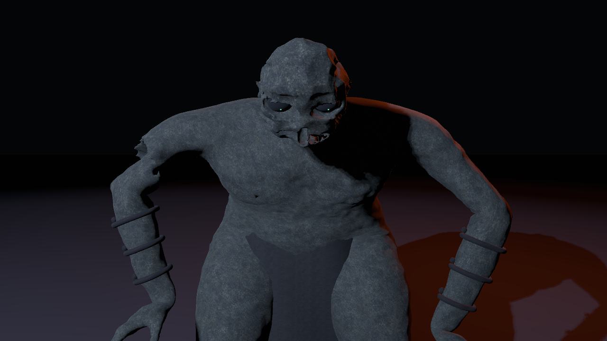

Penitent — actual native19 review.

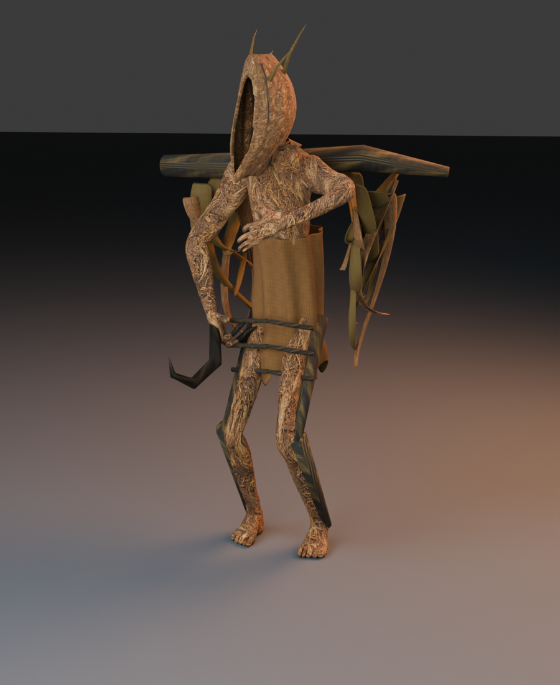

Harvester — Blender concept, not gameplay.

**The Farmer:** A hunched sewn harvest executioner: head concealed by gathered coarse cloth, deep uneven sockets with tiny red points, aged dark workcoat and gravity-hung apron, opposed gloved thumbs and fingers wrapped around a heavy rusted chainsaw. New identity is in native19. Bounded native20 sole/apron correction frozen; visual, attack and floor recheck pending.

**The Penitent:** A broad stooped mortuary guardian: integrated eroded carved skull and crown, hollow eyes with a recessed awake cue, broken asymmetric statuary arms, curved bindings and a short burial wrap. Heavy committed motion should contrast with the other hunters. Distinct 94,570-triangle identity imported and native contact/motion mechanically tested. Final contextual art review and chest-shadow diagnosis remain open.

**The Harvester:** An alien harvest body: extremely tall crooked woven/ribbed husk skull with a narrow deep vertical face, beak-like articulated jaw, buried amber light, asymmetric reed spines, curled husk leaves, long jointed limbs and a creaking harvest yoke. Alien-husk source concept only. Existing playable Corn model still uses the older identity. No new draft promotion or final art approval.

**The Repeater:** An emaciated organic stalker: forward-carried neck, asymmetric damaged skull and jaw, recessed red eyes, sparse partly buried irregular teeth, charred skin with material depth and long searching hands. Should feel like a listening predator rather than a bald human or grinning gorilla. Playable mechanical rig remains the previous candidate. Organic identity draft still needs a stronger distinctive silhouette and face; no image selected as a finished direction.

## Human survivors — native V3 candidate

Four adult survivors share the same grounded horror art style: business, athletic, fashionable and researcher looks. These are native studio review captures; world concealment, interaction and replication acceptance remain separate.

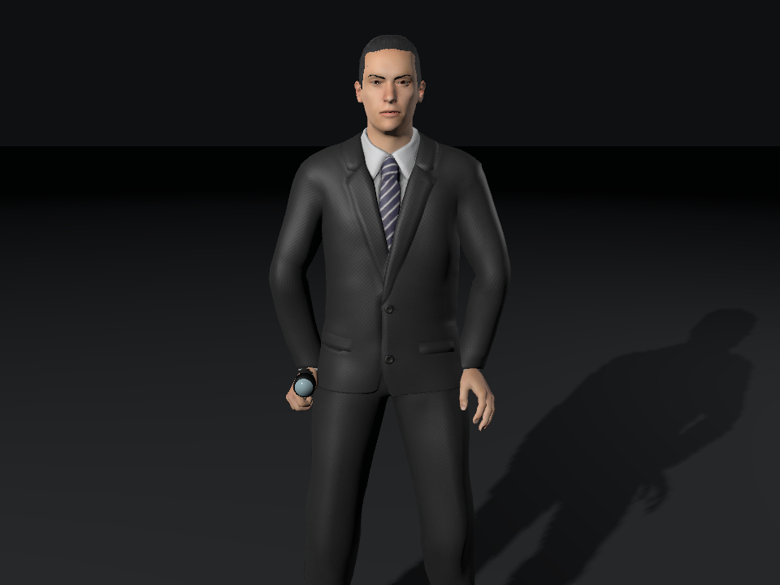

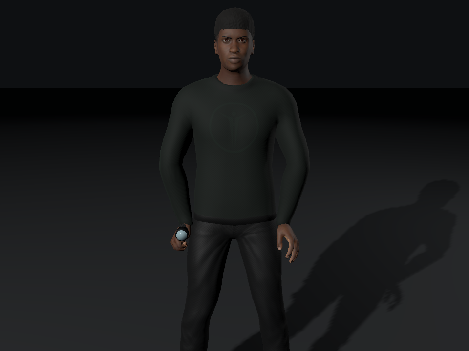

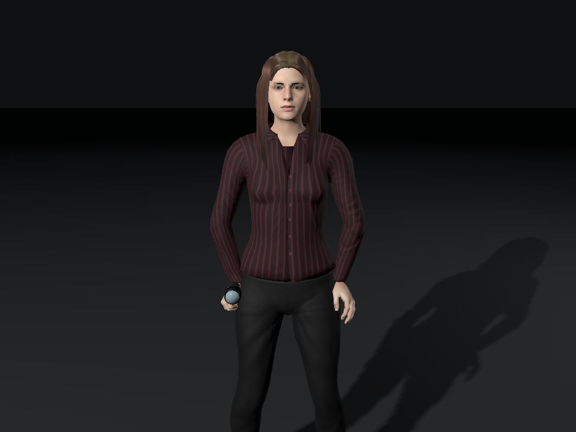

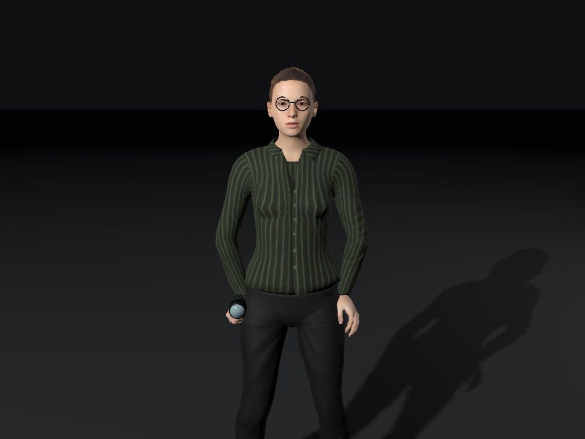

## Player flow and horror rules

Solo: level select → difficulty → saferoom briefing → three useful objectives → final escape hunt → scoreboard → level select.

Co-op: create/join invite-code lobby → choose names/characters → host selects level/difficulty → all ready → separated starts → shared objective progress → individual escape/death outcomes → team results → same connected lobby for the next round. The host leaving ends the hosted session cleanly.

Scoreboards show total time below, first-found and activation times for objectives, and each survivor’s outcome/time. Paused solo menus do not consume the run clock.

Final objective pressure should seek the nearest eligible survivor by path distance and attempt interception. Hiding, sound, voice and broken sight must still matter; silent unseen targets are searched by broad escape-route sectors instead of exact live coordinates.

## What “done” means

- **Building:** active implementation or correction.
- **Needs verification:** a candidate exists; required native/visual/behavior checks remain.
- **Verified:** the issue’s specific acceptance has independent supporting evidence. It does not certify unrelated features or a complete commercial release.

Tests must cover the actual scope: moving native art, solvable physical routes, solo and four-peer behavior, fair hunts, repeat-round recovery, sustained resource use and a clean Windows install. Source compilation and polygon counts are preflight only.

## Constraints

- Windows desktop download and launcher; no browser edition or Linux commitment.
- Four players maximum; host-owned session and invite codes.
- No paid services, billing enablement or subscriptions. Relay usage remains subject to its free allowance.
- Suno download budget:10/10 used. Existing recordings may be edited; no new download is authorized.
- Existing public alpha and the separate Microsoft Store work stay intact while the tested replacement is prepared.

Screenshots and concept classifications: [image manifest](images/manifest.json). Original accepted criteria: [verification snapshot](verification-summary.json).

## Issue index

The linked issues and milestone checklist will appear here after publication verification.
