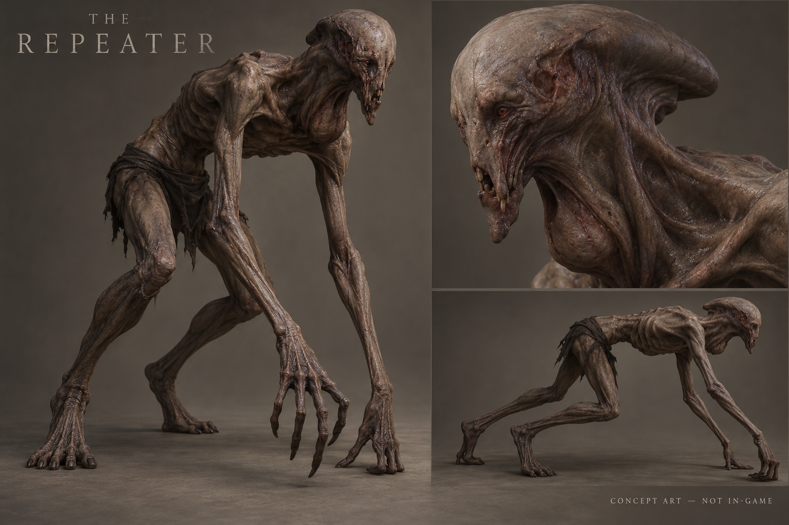
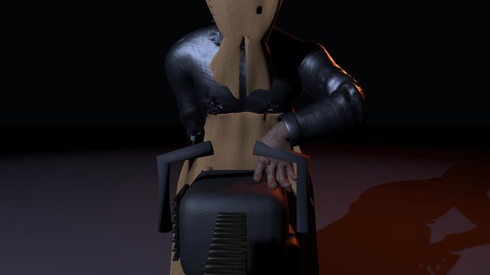
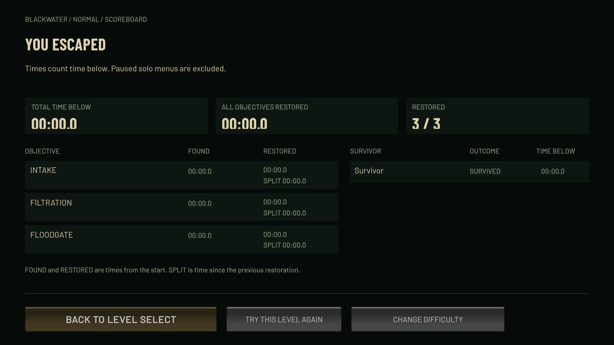

# The Hollow Below — Nightmare Worlds Roadmap

[Project board](https://github.com/users/RyanVerWey/projects/30/views/2) · [Milestones](https://github.com/RyanVerWey/the-hollow-below-alpha/milestones) · [All roadmap issues](https://github.com/RyanVerWey/the-hollow-below-alpha/issues?q=label%3Anightmare-roadmap)

**100 original improvement goals, plus the requested results/party flow, final-objective hunt and end-to-end voice verification.** This is a quality-driven delivery sequence, not a dated launch promise. The original acceptance contract stays intact.

## Where we are

13 original criteria have bounded independent acceptance. The remaining criteria are open: much of the current candidate is implemented, but code, renders and small tests alone do not establish final gameplay or visual quality. The current public download is older than these internal review builds.

Current integration candidate: Windows0.22.21. All four Normal native smoke paths pass; the Farmer boot correction passes native contact tests. Corn/Stone also pass bounded real-Physics arrival-warning checks. Results screens are now captured, but full user interaction, all-tier final-escape fairness and online result/voice flows remain open. This is not advertised as a verified release.

## Visual destination — concept art

AI-generated production direction: material depth, useful props, low practical lighting, distinct monsters and readable haze. This is **not gameplay** and does not establish current fidelity. The target should guide asset, lighting and animation reviews rather than substitute for them.

## Delivery milestones

| Milestone | Outcome | Order and dependency |
|---|---|---|
| [01 - Playable alpha: fair hunts and round flow](https://github.com/RyanVerWey/the-hollow-below-alpha/milestone/1) | The immediate playable update: objectives teach and help, sound and line-of-sight have fair consequences, final escape creates pressure, results explain the run, and multiplayer groups stay connected. | Current playable focus |
| [02 - Human survivors and cooperative presence](https://github.com/RyanVerWey/the-hollow-below-alpha/milestone/2) | Four recognizably human survivors with grounded locomotion, readable hands and faces, convincing concealment, held lights, interaction and replicated body language. | Current playable focus |
| [03 - Blackwater: industrial depth and the Repeater](https://github.com/RyanVerWey/the-hollow-below-alpha/milestone/3) | A wet, decaying pumping station with dimensional machinery, useful hiding and route props, readable darkness, and an organic red-eyed listening predator. | Parallel art/audio; integrate after the shared loop |
| [04 - Briarwake: living estate and chainsaw terror](https://github.com/RyanVerWey/the-hollow-below-alpha/milestone/4) | Tight layered hedges, trees, dirt paths, lanterns clear of foliage, a blood-moon sky and fog. The demonic Farmer must hold, carry and attack with a heavy chainsaw convincingly. | Current playable focus |
| [05 - Last Harvest: corn maze and the Harvester](https://github.com/RyanVerWey/the-hollow-below-alpha/milestone/5) | A connected cold-night corn maze with farm landmarks, beneficial machinery objectives and an alien husk creature whose senses, scares and motion distinguish it from the Farmer. | Parallel art/audio; integrate after the shared loop |
| [06 - The Ossuary: labyrinth and the Penitent](https://github.com/RyanVerWey/the-hollow-below-alpha/milestone/6) | A connected vaulted stone labyrinth with ritual objectives, crypt landmarks, dust and echo. A heavy carved guardian has readable committed attacks and its own phase changes. | Parallel art/audio; integrate after the shared loop |
| [07 - Sound: presence, pursuit and player control](https://github.com/RyanVerWey/the-hollow-below-alpha/milestone/7) | Creature presence carries through halls, proximity warns before visibility, investigation and pursuit have distinct transitions, footsteps belong to surfaces and every audio category can be controlled. | Parallel art/audio; integrate after the shared loop |
| [08 - Performance: depth within a measured budget](https://github.com/RyanVerWey/the-hollow-below-alpha/milestone/8) | Preserve nearby visual depth while bounding foliage, lighting, shadows, repeated geometry, allocations and effects. Use native measurements rather than editor FPS or triangle counts alone. | Continuous measured budget |
| [09 - Windows alpha: native acceptance and delivery](https://github.com/RyanVerWey/the-hollow-below-alpha/milestone/9) | Every world and difficulty must be solvable and playable in solo and four-player sessions, with sustained performance, readable moving art and a clean installer/launcher. Publish only a tested coherent build. | Final integration gate |

Immediate focus: complete the round loop and fair final escape, ship the improved human/monster candidates in one playable build, then finish each world’s distinctive art and encounters. Performance and independent tests run alongside that work.

## Current game — unmodified native captures

These images come from actual Windows review builds. They are not generated or brightened. Inspection routes use real world cameras and controller movement, with gameplay AI disabled for the recorded route; they do not prove a live hunt, keyboard play, four-client networking or performance.

### BLACKWATER — Windows-v02215-worlds-review

Current native corridor view: flashlight-lit station tiles recede into continuous depth haze. The station remains very dark; this view does not show machinery or room dressing clearly.

### BRIARWAKE ESTATE — Windows-v02218-worlds-review

Native estate view after the ward-placement correction: a three-dimensional masonry lantern ward sits beside the clear approach, with hedge layers fading behind it. Foliage and stone remain dark. This is a current-state image, not final environment-art approval.

### THE LAST HARVEST — Windows-v02215-worlds-review

Native field route: an irrigation pump clearing, layered corn rows and distant farm silhouettes beneath the night sky. Blue haze reduces distant contrast, and the open ground still needs stronger visual dressing.

### THE OSSUARY — Windows-v02215-worlds-review

Native crypt corridor: warm near stone, irregular floor relief and cooler haze down the passage. The image remains dim. It demonstrates a corridor rather than the full ritual-room dressing.

## Monsters — current candidate versus direction

The Farmer and Stone candidates below are actual native19 studio renders. The Farmer image predates a boot/garment correction in20; the Stone chest shadow still needs attention. Corn is an output-only source concept. None is final art approval.

Farmer — actual native19 review.

Penitent — actual native19 review.

Harvester — Blender concept, not gameplay.

**The Farmer:** A hunched sewn harvest executioner: head concealed by gathered coarse cloth, deep uneven sockets with tiny red points, aged dark workcoat and gravity-hung apron, opposed gloved thumbs and fingers wrapped around a heavy rusted chainsaw. New identity is in native19. Bounded native20 sole/apron correction frozen; visual, attack and floor recheck pending.

**The Penitent:** A broad stooped mortuary guardian: integrated eroded carved skull and crown, hollow eyes with a recessed awake cue, broken asymmetric statuary arms, curved bindings and a short burial wrap. Heavy committed motion should contrast with the other hunters. Distinct 94,570-triangle identity imported and native contact/motion mechanically tested. Final contextual art review and chest-shadow diagnosis remain open.

**The Harvester:** An alien harvest body: extremely tall crooked woven/ribbed husk skull with a narrow deep vertical face, beak-like articulated jaw, buried amber light, asymmetric reed spines, curled husk leaves, long jointed limbs and a creaking harvest yoke. Alien-husk source concept only. Existing playable Corn model still uses the older identity. No new draft promotion or final art approval.

**The Repeater:** An emaciated organic stalker: forward-carried neck, asymmetric damaged skull and jaw, recessed red eyes, sparse partly buried irregular teeth, charred skin with material depth and long searching hands. Should feel like a listening predator rather than a bald human or grinning gorilla. Playable mechanical rig remains the previous candidate. Organic identity draft still needs a stronger distinctive silhouette and face; no image selected as a finished direction.

Original Repeater anatomy target; this creature has not been built or imported.

Actual native20 Farmer after sole/apron correction. The coat and gripping fingers still need visual improvement.

## Human survivors — native V3 candidate

Four adult survivors share the same grounded horror art style: business, athletic, fashionable and researcher looks. These are native studio review captures; world concealment, interaction and replication acceptance remain separate.

## Player flow and horror rules

**Implementation candidate; full native user-flow/fairness acceptance remains open.**

Solo: level select → difficulty → saferoom briefing → three useful objectives → final escape hunt → scoreboard → level select.

Co-op: create/join invite-code lobby → choose names/characters → host selects level/difficulty → all ready → separated starts → shared objective progress → individual escape/death outcomes → team results → same connected lobby for the next round. The host leaving ends the hosted session cleanly.

Scoreboards show total time below, first-found and activation times for objectives, and each survivor’s outcome/time. Paused solo menus do not consume the run clock.

Final objective pressure should seek the nearest eligible survivor by path distance and attempt interception. Hiding, sound, voice and broken sight must still matter; silent unseen targets are searched by broad escape-route sectors instead of exact live coordinates.

## Native results-screen candidate

The native0.22.21 progression fixtures now render all four terminal scoreboards. These are actual captured pixels, with accelerated/staged fixture clocks rather than normal player completion times. They do not certify multiplayer results or all menu interactions.

[Other native result captures](images/manifest.json) are indexed with their provenance and limits.

## What “done” means

- **Building:** active implementation or correction.
- **Needs verification:** a candidate exists; required native/visual/behavior checks remain.
- **Verified:** the issue’s specific acceptance has independent supporting evidence. It does not certify unrelated features or a complete commercial release.

Tests must cover the actual scope: moving native art, solvable physical routes, solo and four-peer behavior, fair hunts, repeat-round recovery, sustained resource use and a clean Windows install. Source compilation and polygon counts are preflight only.

## Constraints

- Windows desktop download and launcher; no browser edition or Linux commitment.
- Four players maximum; host-owned session and invite codes.
- No paid services, billing enablement or subscriptions. Relay usage remains subject to its free allowance.
- Suno download budget:10/10 used. Existing recordings may be edited; no new download is authorized.
- Existing public alpha and the separate Microsoft Store work stay intact while the tested replacement is prepared.

Screenshots and concept classifications: [image manifest](images/manifest.json). Original accepted criteria: [verification snapshot](verification-summary.json).

## Issue index

100 original goals plus3 explicit follow-ups. Status snapshot:2026-10-25. The live project and issue states take precedence over this exported checklist.

### [01 - Playable alpha: fair hunts and round flow](https://github.com/RyanVerWey/the-hollow-below-alpha/milestone/1)

- [ ] [[AC81] Unify level selection and objectives UI](https://github.com/RyanVerWey/the-hollow-below-alpha/issues/82) — Needs verification
- [ ] [[AC82] Improve objective discoverability](https://github.com/RyanVerWey/the-hollow-below-alpha/issues/83) — Needs verification
- [ ] [[AC83] Tune finite monster evidence and LOS breaks](https://github.com/RyanVerWey/the-hollow-below-alpha/issues/84) — Building
- [ ] [[AC84] Prevent multiplayer target ping-pong](https://github.com/RyanVerWey/the-hollow-below-alpha/issues/85) — Building
- [ ] [[AC85] Add fair tension escalation](https://github.com/RyanVerWey/the-hollow-below-alpha/issues/86) — Building
- [ ] [[AC86] Improve encounter pacing and scare variety](https://github.com/RyanVerWey/the-hollow-below-alpha/issues/87) — Needs verification
- [ ] [[AC87] Make objective attraction fair and legible](https://github.com/RyanVerWey/the-hollow-below-alpha/issues/88) — Building
- [ ] [[AC88] Add meaningful prop interactions](https://github.com/RyanVerWey/the-hollow-below-alpha/issues/89) — Needs verification
- [ ] [[AC89] Improve player feedback and failure recovery](https://github.com/RyanVerWey/the-hollow-below-alpha/issues/90) — Building
- [ ] [[AC90] Improve input and comfort options](https://github.com/RyanVerWey/the-hollow-below-alpha/issues/91) — Building
- [ ] [Round scoreboards and persistent multiplayer parties](https://github.com/RyanVerWey/the-hollow-below-alpha/issues/102) — Building
- [ ] [Final objective: relentless, fair closest-player interception](https://github.com/RyanVerWey/the-hollow-below-alpha/issues/103) — Building

### [02 - Human survivors and cooperative presence](https://github.com/RyanVerWey/the-hollow-below-alpha/milestone/2)

- [x] [[AC41] Correct survivor head, hand and body proportions](https://github.com/RyanVerWey/the-hollow-below-alpha/issues/42) — Verified
- [x] [[AC42] Improve survivor facial materials and eyes](https://github.com/RyanVerWey/the-hollow-below-alpha/issues/43) — Verified
- [x] [[AC43] Improve clothing construction and silhouette](https://github.com/RyanVerWey/the-hollow-below-alpha/issues/44) — Verified
- [x] [[AC44] Improve hair volume and silhouettes](https://github.com/RyanVerWey/the-hollow-below-alpha/issues/45) — Verified
- [x] [[AC45] Rework walking contact and weight transfer](https://github.com/RyanVerWey/the-hollow-below-alpha/issues/46) — Verified
- [x] [[AC46] Rework running and deceleration](https://github.com/RyanVerWey/the-hollow-below-alpha/issues/47) — Verified
- [ ] [[AC47] Add crouch and concealment transitions](https://github.com/RyanVerWey/the-hollow-below-alpha/issues/48) — Building
- [ ] [[AC48] Add held-light and interaction poses](https://github.com/RyanVerWey/the-hollow-below-alpha/issues/49) — Building
- [ ] [[AC49] Add voice/listening and injured body language](https://github.com/RyanVerWey/the-hollow-below-alpha/issues/50) — Building
- [ ] [[AC50] Validate replicated survivor animation](https://github.com/RyanVerWey/the-hollow-below-alpha/issues/51) — Building

### [03 - Blackwater: industrial depth and the Repeater](https://github.com/RyanVerWey/the-hollow-below-alpha/milestone/3)

- [ ] [[AC11] Build dimensional pumping machinery](https://github.com/RyanVerWey/the-hollow-below-alpha/issues/12) — Needs verification
- [ ] [[AC12] Add overhead service runs and cable sag](https://github.com/RyanVerWey/the-hollow-below-alpha/issues/13) — Needs verification
- [ ] [[AC13] Create distinct recognizable station sectors](https://github.com/RyanVerWey/the-hollow-below-alpha/issues/14) — Needs verification
- [ ] [[AC14] Add believable wetness and shallow drainage](https://github.com/RyanVerWey/the-hollow-below-alpha/issues/15) — Needs verification
- [ ] [[AC15] Vary blood and damage storytelling](https://github.com/RyanVerWey/the-hollow-below-alpha/issues/16) — Needs verification
- [ ] [[AC16] Animate failing industrial equipment](https://github.com/RyanVerWey/the-hollow-below-alpha/issues/17) — Needs verification
- [ ] [[AC17] Improve breaker prop and interaction feedback](https://github.com/RyanVerWey/the-hollow-below-alpha/issues/18) — Needs verification
- [ ] [[AC18] Improve safe-room teaching props](https://github.com/RyanVerWey/the-hollow-below-alpha/issues/19) — Needs verification
- [ ] [[AC19] Add useful concealment and route props](https://github.com/RyanVerWey/the-hollow-below-alpha/issues/20) — Needs verification
- [ ] [[AC20] Tune station lighting for readable darkness](https://github.com/RyanVerWey/the-hollow-below-alpha/issues/21) — Needs verification
- [ ] [[AC31] Rebuild the Repeater silhouette and anatomy](https://github.com/RyanVerWey/the-hollow-below-alpha/issues/32) — Building
- [ ] [[AC32] Give Repeater skin physically responsive detail](https://github.com/RyanVerWey/the-hollow-below-alpha/issues/33) — Needs verification
- [ ] [[AC33] Animate Repeater stalking with planted contact](https://github.com/RyanVerWey/the-hollow-below-alpha/issues/34) — Needs verification
- [ ] [[AC34] Animate Repeater chase, crawl and attack](https://github.com/RyanVerWey/the-hollow-below-alpha/issues/35) — Needs verification

### [04 - Briarwake: living estate and chainsaw terror](https://github.com/RyanVerWey/the-hollow-below-alpha/milestone/4)

- [ ] [[AC21] Give hedge faces real three-dimensional foliage](https://github.com/RyanVerWey/the-hollow-below-alpha/issues/22) — Needs verification
- [ ] [[AC22] Create varied botanical hedge silhouettes](https://github.com/RyanVerWey/the-hollow-below-alpha/issues/23) — Needs verification
- [ ] [[AC23] Build old-growth tree variants and roots](https://github.com/RyanVerWey/the-hollow-below-alpha/issues/24) — Needs verification
- [ ] [[AC24] Add a layered night sky and blood-moon halo](https://github.com/RyanVerWey/the-hollow-below-alpha/issues/25) — Needs verification
- [ ] [[AC25] Add wind through foliage and hanging objects](https://github.com/RyanVerWey/the-hollow-below-alpha/issues/26) — Needs verification
- [ ] [[AC26] Create a meaningful abandoned garden prop kit](https://github.com/RyanVerWey/the-hollow-below-alpha/issues/27) — Needs verification
- [ ] [[AC27] Finish lantern mounting and clearance](https://github.com/RyanVerWey/the-hollow-below-alpha/issues/28) — Needs verification
- [ ] [[AC28] Deepen dirt paths with natural edges](https://github.com/RyanVerWey/the-hollow-below-alpha/issues/29) — Needs verification
- [ ] [[AC29] Make ward activation theatrical and useful](https://github.com/RyanVerWey/the-hollow-below-alpha/issues/30) — Needs verification
- [ ] [[AC30] Improve Briarwake shelters and escape gate](https://github.com/RyanVerWey/the-hollow-below-alpha/issues/31) — Needs verification
- [ ] [[AC35] Rebuild Thornkeeper as a readable demonic farmer](https://github.com/RyanVerWey/the-hollow-below-alpha/issues/36) — Building
- [ ] [[AC36] Animate Thornkeeper chainsaw locomotion and attacks](https://github.com/RyanVerWey/the-hollow-below-alpha/issues/37) — Building

### [05 - Last Harvest: corn maze and the Harvester](https://github.com/RyanVerWey/the-hollow-below-alpha/milestone/5)

- [ ] [[AC37] Build the corn monster with its own visual identity](https://github.com/RyanVerWey/the-hollow-below-alpha/issues/38) — Building
- [ ] [[AC38] Animate corn creature listening and lunging](https://github.com/RyanVerWey/the-hollow-below-alpha/issues/39) — Needs verification
- [x] [[AC51] Generate a distinct connected corn maze](https://github.com/RyanVerWey/the-hollow-below-alpha/issues/52) — Verified
- [ ] [[AC52] Build dimensional corn rows](https://github.com/RyanVerWey/the-hollow-below-alpha/issues/53) — Needs verification
- [ ] [[AC53] Create farmyard safe staging](https://github.com/RyanVerWey/the-hollow-below-alpha/issues/54) — Needs verification
- [ ] [[AC54] Add three beneficial harvest objectives](https://github.com/RyanVerWey/the-hollow-below-alpha/issues/55) — Needs verification
- [ ] [[AC55] Build windmill, silo and derelict machinery landmarks](https://github.com/RyanVerWey/the-hollow-below-alpha/issues/56) — Needs verification
- [ ] [[AC56] Create a cold harvest night atmosphere](https://github.com/RyanVerWey/the-hollow-below-alpha/issues/57) — Needs verification
- [ ] [[AC57] Implement corn-specific monster senses](https://github.com/RyanVerWey/the-hollow-below-alpha/issues/58) — Needs verification
- [ ] [[AC58] Create corn-specific scares and dynamic events](https://github.com/RyanVerWey/the-hollow-below-alpha/issues/59) — Needs verification
- [ ] [[AC59] Integrate corn progression and multiplayer](https://github.com/RyanVerWey/the-hollow-below-alpha/issues/60) — Needs verification
- [ ] [[AC60] Balance four corn difficulties](https://github.com/RyanVerWey/the-hollow-below-alpha/issues/61) — Needs verification
- [ ] [[AC71] Generate a corn ambient score in Suno](https://github.com/RyanVerWey/the-hollow-below-alpha/issues/72) — Needs verification
- [ ] [[AC72] Generate corn creature audio in Suno](https://github.com/RyanVerWey/the-hollow-below-alpha/issues/73) — Needs verification

### [06 - The Ossuary: labyrinth and the Penitent](https://github.com/RyanVerWey/the-hollow-below-alpha/milestone/6)

- [ ] [[AC39] Build the stone monster with its own visual identity](https://github.com/RyanVerWey/the-hollow-below-alpha/issues/40) — Needs verification
- [ ] [[AC40] Animate stone guardian weight and phase changes](https://github.com/RyanVerWey/the-hollow-below-alpha/issues/41) — Needs verification
- [x] [[AC61] Generate a distinct connected stone labyrinth](https://github.com/RyanVerWey/the-hollow-below-alpha/issues/62) — Verified
- [ ] [[AC62] Build dimensional masonry and carved arches](https://github.com/RyanVerWey/the-hollow-below-alpha/issues/63) — Needs verification
- [ ] [[AC63] Create an underground refuge and instructions](https://github.com/RyanVerWey/the-hollow-below-alpha/issues/64) — Needs verification
- [ ] [[AC64] Add three beneficial seal objectives](https://github.com/RyanVerWey/the-hollow-below-alpha/issues/65) — Needs verification
- [ ] [[AC65] Build meaningful crypt landmark props](https://github.com/RyanVerWey/the-hollow-below-alpha/issues/66) — Needs verification
- [ ] [[AC66] Create a subterranean atmosphere](https://github.com/RyanVerWey/the-hollow-below-alpha/issues/67) — Needs verification
- [ ] [[AC67] Implement guardian-specific hunting behavior](https://github.com/RyanVerWey/the-hollow-below-alpha/issues/68) — Needs verification
- [ ] [[AC68] Create stone-specific ambient events and scares](https://github.com/RyanVerWey/the-hollow-below-alpha/issues/69) — Needs verification
- [ ] [[AC69] Integrate labyrinth progression and multiplayer](https://github.com/RyanVerWey/the-hollow-below-alpha/issues/70) — Needs verification
- [ ] [[AC70] Balance four labyrinth difficulties](https://github.com/RyanVerWey/the-hollow-below-alpha/issues/71) — Needs verification
- [ ] [[AC73] Generate a stone ambient score in Suno](https://github.com/RyanVerWey/the-hollow-below-alpha/issues/74) — Needs verification
- [ ] [[AC74] Generate stone guardian audio in Suno](https://github.com/RyanVerWey/the-hollow-below-alpha/issues/75) — Needs verification

### [07 - Sound: presence, pursuit and player control](https://github.com/RyanVerWey/the-hollow-below-alpha/milestone/7)

- [x] [[AC75] Master and loop the new audio cleanly](https://github.com/RyanVerWey/the-hollow-below-alpha/issues/76) — Verified
- [x] [[AC76] Make creature distance audible before visibility](https://github.com/RyanVerWey/the-hollow-below-alpha/issues/77) — Verified
- [ ] [[AC77] Add environment-aware echo character](https://github.com/RyanVerWey/the-hollow-below-alpha/issues/78) — Needs verification
- [ ] [[AC78] Add layered adaptive pursuit music](https://github.com/RyanVerWey/the-hollow-below-alpha/issues/79) — Building
- [ ] [[AC79] Add surface and movement footstep variety](https://github.com/RyanVerWey/the-hollow-below-alpha/issues/80) — Needs verification
- [ ] [[AC80] Add clear audio and dynamic-range controls](https://github.com/RyanVerWey/the-hollow-below-alpha/issues/81) — Needs verification
- [ ] [Finish and verify free push-to-talk/open-mic voice and monster hearing](https://github.com/RyanVerWey/the-hollow-below-alpha/issues/104) — Needs verification

### [08 - Performance: depth within a measured budget](https://github.com/RyanVerWey/the-hollow-below-alpha/milestone/8)

- [x] [[AC1] Record native CPU/GPU/frame-time baselines](https://github.com/RyanVerWey/the-hollow-below-alpha/issues/2) — Verified
- [ ] [[AC2] Add distance LOD to large outdoor trees](https://github.com/RyanVerWey/the-hollow-below-alpha/issues/3) — Needs verification
- [ ] [[AC3] Instance repeated foliage and prop materials](https://github.com/RyanVerWey/the-hollow-below-alpha/issues/4) — Needs verification
- [ ] [[AC4] Cull distant shadow casters by quality tier](https://github.com/RyanVerWey/the-hollow-below-alpha/issues/5) — Needs verification
- [x] [[AC5] Replace square ground fog with layered world haze](https://github.com/RyanVerWey/the-hollow-below-alpha/issues/6) — Verified
- [ ] [[AC6] Add stable material depth and roughness variation](https://github.com/RyanVerWey/the-hollow-below-alpha/issues/7) — Needs verification
- [ ] [[AC7] Bound dynamic light count and range](https://github.com/RyanVerWey/the-hollow-below-alpha/issues/8) — Needs verification
- [ ] [[AC8] Pool recurring scares and particles](https://github.com/RyanVerWey/the-hollow-below-alpha/issues/9) — Needs verification
- [ ] [[AC9] Remove recurring hunt allocations and redundant path work](https://github.com/RyanVerWey/the-hollow-below-alpha/issues/10) — Needs verification
- [ ] [[AC10] Expose coherent visual quality presets](https://github.com/RyanVerWey/the-hollow-below-alpha/issues/11) — Needs verification

### [09 - Windows alpha: native acceptance and delivery](https://github.com/RyanVerWey/the-hollow-below-alpha/milestone/9)

- [ ] [[AC91] Automate maze solvability for every seed and tier](https://github.com/RyanVerWey/the-hollow-below-alpha/issues/92) — Needs verification
- [ ] [[AC92] Audit prop and animation collision clearance](https://github.com/RyanVerWey/the-hollow-below-alpha/issues/93) — Building
- [ ] [[AC93] Exercise every world in native solo](https://github.com/RyanVerWey/the-hollow-below-alpha/issues/94) — Building
- [x] [[AC94] Exercise every world in four-player sessions](https://github.com/RyanVerWey/the-hollow-below-alpha/issues/95) — Verified
- [ ] [[AC95] Stress monster behavior deterministically](https://github.com/RyanVerWey/the-hollow-below-alpha/issues/96) — Building
- [ ] [[AC96] Review every monster in native moving footage](https://github.com/RyanVerWey/the-hollow-below-alpha/issues/97) — Building
- [ ] [[AC97] Review all environments in native moving footage](https://github.com/RyanVerWey/the-hollow-below-alpha/issues/98) — Building
- [ ] [[AC98] Run sustained performance and leak checks](https://github.com/RyanVerWey/the-hollow-below-alpha/issues/99) — Building
- [ ] [[AC99] Verify a clean Windows install and launcher](https://github.com/RyanVerWey/the-hollow-below-alpha/issues/100) — Building
- [ ] [[AC100] Complete independent acceptance and release notes](https://github.com/RyanVerWey/the-hollow-below-alpha/issues/101) — Building
